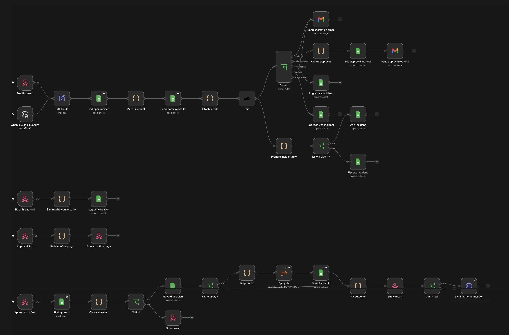

# What is Domain Guard?

Domain Guard is an AI-powered domain monitoring system that I built with the RaiaAI and n8n platform. It is designed to help users maintain large domain portfolios by constantly monitoring the domains and troubleshooting domains when there are errors. What differentiates Domain Guard with other domain management tools is its ability to perform one-click approved fixes.

# How does Domain Guard work?

**Watching the Domains**

* Domain Guard conducts hourly checks on all domains to detect whether it is running, if there is an alert it will alert the agent, which will then notify the user if necessary.
* Domain Guard checks all domain’s registration on a daily basis and flags if there are any domains that are expired, about to expire, or on hold.
* Domain Guard performs a daily comparison with how the domain looked the day before and its expected settings to monitor any changes.

**Diagnosing Problems**

* When there is an alert, Domain Guard will open an incident and hand it to the agent, along with other necessary material. Then, the agent will log the incident and if necessary, notify the user with the diagnosis, the status, and the next steps.
* Domain Guard conducts diagnostics with five tools: HTTP accessibility, DNS configurations (such as mail authentication controls), TLS/SSL certificates, URL forwarding rules, and RDAP registration data. It then ends each diagnosis with a clear status: resolved, investigating, escalated, or awaiting approval.

**Solving Errors**

* If there is an error that Domain Guard has confidence it can resolve, it will request permission through email from the user, where if the user grants permission, it will resolve the issue. This usually pertains to simple DNS changes. (This capability requires a Cloudflare token to be connected)
* Domain Guard escalates errors to the user if it assesses that it cannot resolve it.

# What tools did I use to build Domain Guard?

**RaiaAI**

* Domain Guard is hosted on RaiaAI. Here, the agent’s instructions, knowledge base (four reference documents which are attached under knowledge in this repo), and five diagnostic tools it can call.

**n8n**

* Domain Guard’s automatic structure is built in n8n. Here, workflows dictate the scheduled checks, incident tracking, approvals, simple fixes, the weekly report, and failure alerts.

**n8n workflow**

