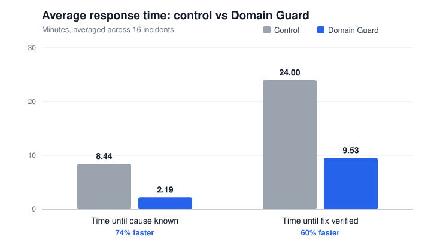

# Domain Guard: Test Results

## How this was tested

Domain Guard monitored a 43-domain portfolio for one month. For each of the 16 incidents that came up, Domain Guard's response time was recorded and compared with an estimate of how long a user would take to find and fix the same error manually (the control). Both were measured in minutes at two points: when the cause was known, and when the fix was verified. The incidents included missing DMARC and broken SPF records, HTTP 5xx outages, DNS rotation alerts, a wrong A record target, an expiring domain, self-recovering outages and false alarms.

## Response time

Across 16 incidents, Domain Guard found the cause 74% faster (8.44 → 2.19 minutes) and reached a verified fix 60% faster (24.00 → 9.53 minutes). Full data: [response-time-results.md](response-time-results.md).
